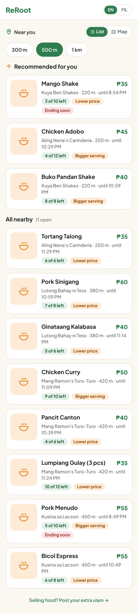
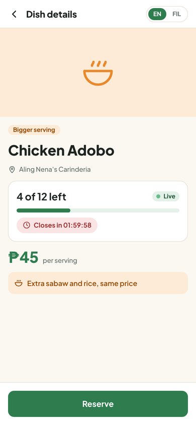
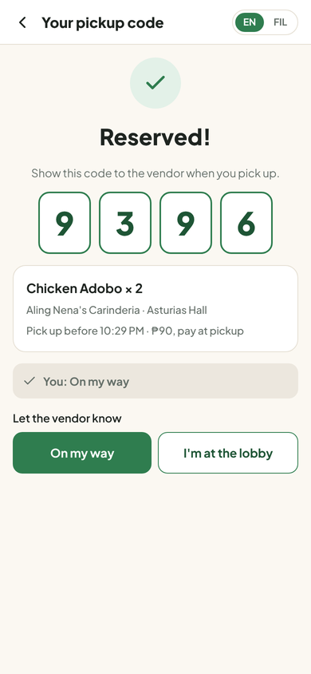
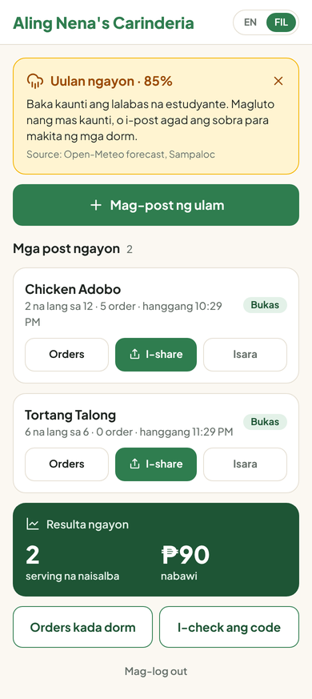
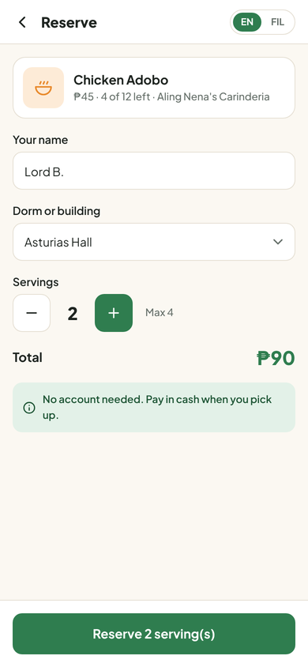
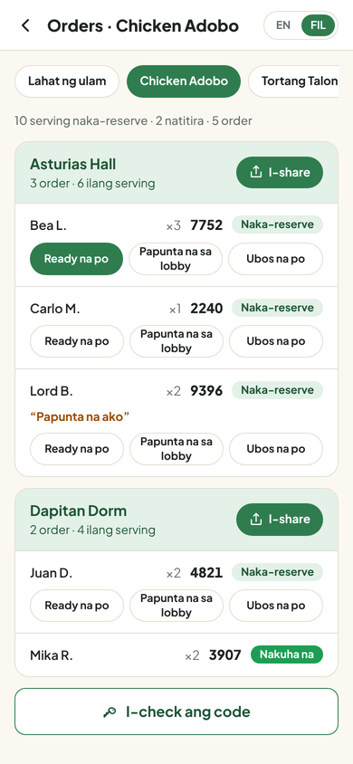
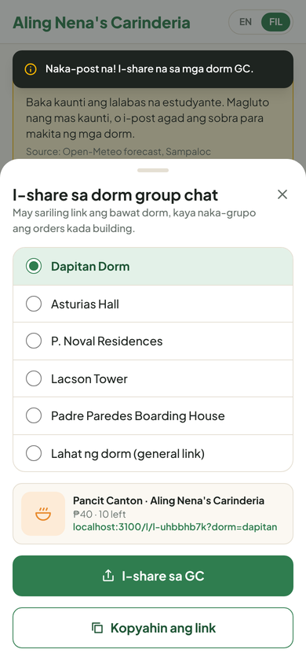
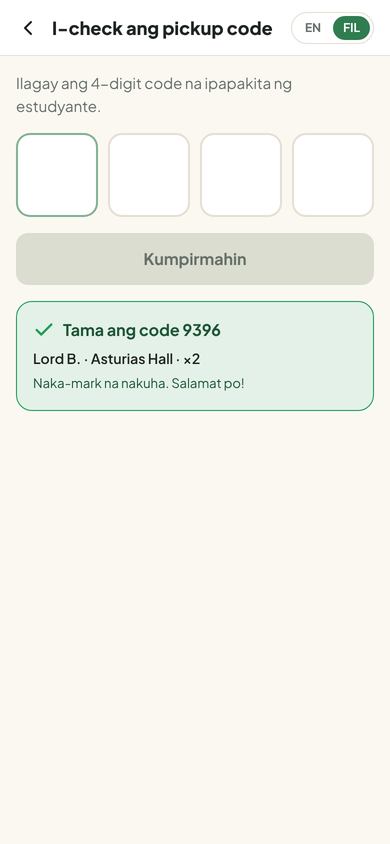

# ReRoot

**Tirang ulam, hindi tirang lugi.** ReRoot is a mobile web app that helps prepare-ahead food vendors near UST sell their same-day surplus to nearby students, especially on slow days like class suspensions and heavy rain.

Built during **CSSprint 2026: Rooted in Innovation** (UST Computer Science Society) by **Team Root Lords**.

**Live app:** [LIVE_LINK_HERE] · **Demo video:** [VIDEO_LINK_HERE] · **Pitch deck:** [DECK_LINK_HERE]

<p>
  
  
  
  
</p>

---

## 1. The problem

Small food vendors near UST cook or prepare food **before** customers arrive. When demand drops without warning (a class suspension, heavy rain), the food and the money spent on ingredients are lost. Delivery apps don't help: they charge about 20–33% commission, which a ₱45 dish cannot absorb.

**Problem statement:** Prepare-ahead micro food vendors near UST lose money on food surplus because demand drops without warning, and they have no affordable, fast way to reach the customers still nearby.

### Evidence

- **Slow days are common.** From August 1 to September 15, 2026, 12 of 28 class days were cancelled in Metro Manila and nearby provinces, about 43% [1]. Disasters disrupted 69 school days nationwide in 2025 [2], and DepEd is preparing modified class days for SY 2026–27 because of a possible strong El Niño [3].
- **Every unsold serving costs more.** In April 2026, carinderia owners raised dish prices by ₱10–15 as LPG, rice, meat and cooking oil became more expensive [4].
- **Food waste is large.** The Philippines wastes about 2,175 tons of food every day [5].
- **Existing channels don't fit.** Delivery apps charge about 20–33% commission [6]. Surplus-food apps work abroad (Too Good To Go has 120 million users in 21 countries), but we found no Philippine launch [7].
- **The area is dense.** UST is one of about 56 schools in Manila's University Belt [8].

### Field results (our interviews, Oct 22, 2026)

| | Fruit shake vendor | Carinderia |
| --- | --- | --- |
| Prepares food ahead? | Yes: pre-cuts fruit, buys about 3 days of stock | No: cooks only when there is an order |
| Loss on slow days | "Minsan 50 to 70%"; doesn't open on heavy-rain days | Sales drop, but little surplus |
| Biggest problem | Competition | Competition |
| Would use the app? | Yes | Yes, "kung makakatulong" |

**What we learned:** surplus comes from preparing ahead, so we target prepare-ahead vendors. The shake vendor gives bigger portions instead of discounts, so ReRoot lets vendors offer **a lower price or a bigger serving**. Two interviews is a small sample; we treat them as first-hand signals backed by the published data above.

**Student survey:** [results pending: fill in from the survey summary in "ReRoot Copy & Data" before submitting]

## 2. Target users

| | |
| --- | --- |
| **Primary** | Micro food vendors (up to ₱3M assets, 9 or fewer workers) in Sampaloc, Manila, who prepare food ahead: cook-ahead carinderias, turo-turo stalls, and stalls that pre-cut fruit or prepare perishables |
| **Secondary** | Students living in dorms and boarding houses near UST (Dapitan, Asturias, P. Noval, Lacson) |
| **Why MSMEs** | Large chains have POS data, planning teams and delivery contracts. A carinderia has a notebook and gut feel, and one bad day can erase several days of profit. |

## 3. The solution

**Core loop:** the vendor posts a dish → nearby students see it live → a student reserves with no account → they get a pickup code → the vendor confirms the handoff.

**What makes it new**
1. **Event-triggered:** a low-demand alert built on a real rain forecast and class suspensions warns vendors in the morning, so they can cook less or post early.
2. **Nothing to install:** listings travel through the dorm group chats students already use, as a link with a preview card.
3. **No account needed to buy:** students can reserve as guests; an account only saves their name and dorm.
4. **Pickup only, grouped by dorm:** each dorm gets its own share link, so the vendor sees who is coming from which building. Students pick up at the carinderia with their code; there are no deliveries.
5. **No commission:** free for vendors, free for students.

### Features

| Feature | Tier |
| --- | --- |
| Vendor posts a dish in seconds: name, servings, lower price (with optional regular price, shown as "₱90 → ₱60 · 33% off") or bigger serving, cutoff, max orders | 1 |
| Live availability ("4 of 12 left") and auto-close when sold out, full, or past cutoff | 1 |
| One login for everyone; after sign-up the user chooses **Student** or **Vendor** | 1 |
| Student reserves as a guest or with an account (saved name and dorm) and gets a 4-digit pickup code | 1 |
| Vendor sees orders grouped by dorm and confirms pickups on **Order Codes** (type the code, or confirm from the live "Waiting for pickup" list) | 1 |
| Student home: top 3 recommendations, then nearby vendors by radius (300 m / 500 m / 1 km), list or map | 2 |
| Low-demand alert from the Open-Meteo rain forecast and a class-suspension switch | 2 |
| One-tap share to dorm group chats with a preview card and dorm-specific links | 2 |
| Filipino / English toggle (vendors default to Filipino) | 2 |
| Sale alerts for buyers: when a nearby vendor posts a discounted dish, students get a push notification (app closed, via FCM) or an in-app banner (app open), e.g. "Sale near you: 33% off!" | 3 |
| Inbox: a chat for every order between the student and the vendor, with quick replies ("On my way", "I'm here", "Ready na po", "Sorry, sold out"), unread badges, and alerts | 3 |
| Notifications: new messages (both sides) and new orders (vendor) as a banner in the app, a system notification in the background, and a push when the app is closed (Firebase mode) | 3 |
| Vendors can add a dish photo when posting (resized on the phone before upload) | 2 |
| Results card: servings saved and pesos recovered today | 3 |
| One login for everyone; choose Student or Vendor after sign-up; students can also reserve as guests | Account |
| My orders, cancel a reservation, profile and settings (language, notifications, default radius), forgot password | Account |
| Search, splash, welcome intro, 404, help, privacy policy, terms; phone, iPad and desktop layouts | UX |

<!-- A9 / final check: remove any row that does not work on the live app and move it to the Roadmap. -->

**Recommendation ranking** (simple and explainable):
`score = 40 × (1 − distance ÷ radius) + 30 × (1 − minutesLeft ÷ 180, min 0) + 20 × (1 − price ÷ highest price shown) + 10 if the student bought from this vendor before`. The top 3 show as "Recommended"; everyone else is sorted by distance.

<p>
  
  
  
  
</p>

## 4. Tech stack

<!-- JC: confirm this section (J8) -->

| Part | Choice |
| --- | --- |
| Framework | Next.js (App Router, JavaScript) + Tailwind CSS |
| Database + realtime | Cloud Firestore (asia-southeast1) |
| Login | Firebase Auth email/password for everyone, role (student or vendor) chosen after sign-up; anonymous sign-in for guest students |
| Push | Firebase Cloud Messaging (web push) + a Next.js API route using firebase-admin |
| Map | Leaflet with OpenStreetMap tiles (student map, dish pickup map, vendor pickup-pin picker) |
| Weather | Open-Meteo forecast API (Sampaloc, 14.61, 120.99) |
| Sharing | Web Share API, copy-link fallback, Open Graph preview cards |
| Hosting | Vercel |

**Security:** reservations go through a Firestore transaction, so two students can never get the last serving. Security rules let only the owning vendor edit a listing and let students read only their own reservations. No secrets are committed to this repo.

### Run it locally

```bash
git clone https://github.com/Vena011/CSSPRINT-Root_Lords.git
cd CSSPRINT-Root_Lords
npm install
cp .env.example .env.local   # then fill in the values (ask JC)
npm run dev                  # http://localhost:3000
```

Environment variables (names only): `NEXT_PUBLIC_FIREBASE_API_KEY`, `NEXT_PUBLIC_FIREBASE_AUTH_DOMAIN`, `NEXT_PUBLIC_FIREBASE_PROJECT_ID`, `NEXT_PUBLIC_FIREBASE_STORAGE_BUCKET`, `NEXT_PUBLIC_FIREBASE_MESSAGING_SENDER_ID`, `NEXT_PUBLIC_FIREBASE_APP_ID`, `NEXT_PUBLIC_FIREBASE_VAPID_KEY`, `FIREBASE_SERVICE_ACCOUNT` (server only).

**Demo logins:** vendor nena@reroot.test, student student@reroot.test (demo data in `data/demo-seed.json`). New users sign up at `/login`, choosing Student or Vendor on the sign-up form.

### Folder structure

```
app/            pages (/login, /onboarding; student: /, /l/[id], /l/[id]/reserve, /r/[id]; vendor: /vendor/...)
app/api/        server routes (push notifications)
components/     UI components (ListingCard, ShareSheet, MapView, ...)
lib/            data layer (db.js), copy (EN/FIL), ranking, geo, demo data
data/           demo seed data
public/         icons, logo, preview image, manifest, service worker
docs/           screenshots
```

## 5. Roadmap

| Version | Adds |
| --- | --- |
| v2 | Automatic class-suspension feed (no manual switch), GCash payments, no-show tracking |
| v3 | Suki points for repeat buyers; prices that drop toward closing time |
| v4 | "Cook less" guide from each vendor's own sales and leftover history; snap-a-photo posting |
| v5 | Other University Belt campuses, then other school and office districts; rider batches per dorm; native app |

## 6. Team Root Lords

| Member | Role |
| --- | --- |
| Lord Benedict Janda | Team leader, design (Figma, style guide, logo, deck), submissions |
| John Carlo "JC" Mananes | Lead developer: Firebase, data layer, security rules, API, deployment, push |
| Lawrence Christian Bonus | Developer: screens and components, map, sharing, styling |
| Aleia Cejas | Contents: problem research, interviews, survey, UI copy, demo data, pitch content |

## 7. Credits

Built during **CSSprint 2026: Rooted in Innovation**, UST Computer Science Society, by Team Root Lords. No code, designs or text from earlier projects were used.

| What | Used for | License |
| --- | --- | --- |
| [Next.js](https://nextjs.org) | App framework (App Router) | MIT |
| [React](https://react.dev) | UI library | MIT |
| [Tailwind CSS](https://tailwindcss.com) | Styling | MIT |
| [Firebase](https://firebase.google.com) (Firestore, Auth, Cloud Messaging) | Database, login, push notifications | Apache-2.0 (SDK) |
| [Leaflet](https://leafletjs.com) | Map | BSD-2-Clause |
| [OpenStreetMap](https://www.openstreetmap.org/copyright) | Map tiles and data | ODbL, © OpenStreetMap contributors |
| [Open-Meteo](https://open-meteo.com) | Rain forecast for the low-demand alert | CC BY 4.0 |
| [Plus Jakarta Sans](https://fonts.google.com/specimen/Plus+Jakarta+Sans) via [@fontsource](https://fontsource.org) | Typeface | SIL Open Font License 1.1 |
| [Lucide](https://lucide.dev) | Icon shapes (SVG paths adapted in components/ui.js) | ISC |
| Logo, app icons, preview image | Designed by the team in Figma during the event | Original |
| [Figma](https://figma.com) | Wireframes, style guide, screens | Tool |
| [Claude](https://claude.ai) (Anthropic) | AI assistant for design drafts, code drafts, copy drafts and debugging. All AI-assisted code was reviewed, understood and committed by team members. | Tool |

<!-- JC: check every library above against package.json before submitting. -->

## Sources

1. Philippine Canadian Inquirer, ["Blanket class suspensions: the growing cost to Filipino students' learning"](https://canadianinquirer.net/2026/09/16/blanket-class-suspensions-the-growing-cost-to-filipino-students-learning/), Sept 16, 2026 (EDCOM 2 analysis)
2. The Data Dictionary, ["Suspended, cancelled and lost"](https://www.data-dict.com/class-suspensions/), Jan 3, 2026
3. Daily Tribune, ["Shorter class days loom due El Niño"](https://tribune.net.ph/2026/10/19/shorter-class-days-loom-due-el-ni%C3%B1o), Oct 19, 2026
4. MindaNews, ["Carenderia owners, food stall vendors raise prices"](https://mindanews.com/top-stories/2026/04/carenderia-owners-food-stall-vendors-raise-prices-but-customers-understand/), Apr 19, 2026
5. Manila Bulletin, ["Help reduce food wastage"](https://mb.com.ph/2025/12/04/help-reduce-food-wastage), Dec 4, 2025 (DOST-FNRI data)
6. Klikit, ["Food delivery commission fees in the Philippines"](https://klikit.io/en/learn/food-delivery-commission-fees-philippines-guide), May 26, 2026
7. PR Newswire, ["Too Good To Go launches in Japan"](https://www.prnewswire.com/news-releases/worlds-largest-marketplace-for-surplus-food-too-good-to-go-launches-in-japan-302672081.html), Jan 28, 2026
8. Wikipedia, ["University Belt"](https://en.wikipedia.org/wiki/University_Belt)
